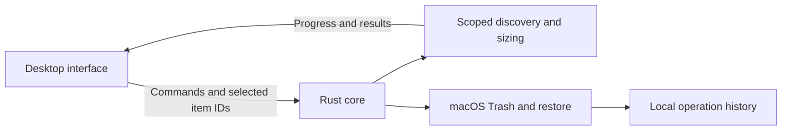

# Mac Cleaner — planning draft

Implementation note (2026-10-19): the reference image became available and the first local application is implemented. See README.md for the delivered scope and VALIDATION.md for test evidence and remaining release checks. The original planning decisions below are retained as context; they are not a claim that every release gate is complete.

The agreed scope is a macOS utility that explains where developer storage goes, lets people choose individual items, and moves those items to Trash with a recovery path. The user confirmed Rust with a Tauri desktop interface, then authorized implementation. The original planning choices follow; implementation and validation details are maintained in README.md and VALIDATION.md.

## Product direction

**Find the space. Understand the files. Choose what goes.**

The primary audience is Mac developers with Xcode data, application caches, and JavaScript projects. The first version also includes uninstalling ordinary applications. It operates locally and needs no account or server.

“Scan in about 10 seconds” is a performance target to validate, not a proven claim. Show useful results as they arrive, and distinguish partial results from a completed scan. Do not display a completed scan at ten seconds if work remains.

## First version

| Area | What appears | Explanation and boundaries |
| --- | --- | --- |
| Xcode | Per-project DerivedData and explicitly supported Xcode cache locations | Explain that builds and indexes will be regenerated. Preserve source projects. Archives, simulator devices, and runtimes are outside the initial cleanup scope. |
| Caches | Recognized entries inside the current user's cache locations | Explain the owning app and likely regeneration or download cost. Unrecognized folders remain visible for inspection but cannot be cleaned until a rule supports them. Never classify all of Library as disposable. |
| node_modules | Dependency folders inside project roots chosen by the user | Show the parent project, path, measured size, and modification time. Explain that reinstalling dependencies may require network access and locally modified dependencies would be removed. Preserve manifests and lockfiles. |
| Applications | Ordinary app bundles in /Applications and ~/Applications, including supported subfolders | Show bundle identity, version, location, and size. Review the bundle and confidently associated files separately. Running apps must be quit before removal. |
| History | Each cleanup operation and its per-item outcome | Restore available items or reveal them in Trash. Report missing items and conflicts honestly. |

Related app files are candidates, not proof of ownership: require exact bundle identity or a documented app-specific rule. Do not use fuzzy name matching or select shared vendor folders. App support data and preferences need separate explicit selection and a clear explanation of what could be lost. Leave documents and shared containers out of the initial uninstaller.

Some apps need their own uninstaller to remove extensions or background components; Apple recommends that route when available. Show guidance for these apps rather than claiming complete removal by trashing the bundle. Vendor uninstallers are outside this app's Trash recovery guarantee and are not launched automatically. See [Apple's uninstall guidance](https://support.apple.com/en-us/102610).

## Interface concept

Provisional direction: a quiet macOS utility with a narrow sidebar, a sortable item table, and a details pane. Use system typography, restrained blue actions, clear separators, and standard keyboard focus. Start with system appearance. The reference screenshot could not be read, so no colors, layout details, or styling are claimed to match it.

```text
 Mac Cleaner          Developer storage                     [Scan]
 ─────────────────────────────────────────────────────────────────
 Overview             Search results…              Sort: Size ↓
 Xcode                □ Item              Size      Modified
 Caches               □ Project / build   4.2 GB    Oct 12
 node_modules         □ web/node_modules  1.8 GB    Oct 03
 Applications
                      Details: project build data
 History              Full path · What it is · Removal consequence
 Settings             [Show in Finder]
 ─────────────────────────────────────────────────────────────────
                      0 items selected       [Review selection]
```

The numbers above are illustrative, not measurements of this Mac.

Every result needs a name, category, full path, measured or pending size, explanation, and consequence of removal. A modification timestamp must not be presented as “last used.” Use plain text labels such as “Rebuild required,” “Reinstall dependencies,” “Contains app data,” and “Access needed”; do not rely on color alone.

Clicking a row opens details; its checkbox selects it. All checkboxes start unchecked. Category selection must show how many items it affects, and newly arriving scan results must stay unchecked. The footer shows the explicit selection total. “Review selection” opens a sheet listing exactly those paths and consequences, followed by “Move N items to Trash.”

Show scanning, cancellation, empty results, inaccessible folders, changing sizes, and partial failure as normal states. When a size is still being calculated, show “Calculating” rather than zero. Controls need accessible labels, keyboard operation, visible focus, and support for reduced motion.

## Scan behavior and the ten-second target

1. Scan known Xcode and cache roots first. Discover apps separately without recursively treating app contents as cleanup candidates.
2. Ask the user to select project roots for node_modules discovery. Do not recursively walk the entire home directory by default.
3. Stream discoveries and size updates from bounded background workers. Keep the interface responsive and allow cancellation.
4. During discovery, skip .git internals, symlink targets, unselected volumes, and cloud placeholders. Once a node_modules folder is found, size that tree without creating duplicate nested cleanup candidates.
5. Use filesystem metadata for sizing, without opening file contents. Account for overlapping candidates and hard links; label totals as estimates because allocated storage and eventual reclaimed space can differ.
6. Track inaccessible paths and incomplete measurements. An interrupted or permission-limited scan must not appear complete.

Benchmark on a documented Apple Silicon Mac with an internal SSD and a fixed corpus covering Xcode, caches, and small and large projects. Record first-result latency, total completion time, entry count, and cold/warm p50/p95 across repeated runs. Aim for a complete typical scoped scan around ten seconds, with an early target of useful results within one second. Very large dependency trees may take longer; optimize after measuring, and publish the scope with any speed claim.

## Cleanup and recovery contract

- The Rust backend owns scan results. The UI requests actions using scan and item IDs; it cannot submit an arbitrary filesystem path for deletion.
- Before moving an item, revalidate its identity, type, allowed root, ancestry, and overlap with other selections. Refuse stale or swapped candidates. Do not follow symlinks or proceed through unexpected mounts. Fail closed where safe identity validation is unavailable.
- Keep system locations, project source, documents, and unsupported data outside cleanup rules. Check relevant running apps before modifying their caches or bundles; explain that active builds and processes must be stopped.
- Use the native macOS Trash operation. Capture its actual destination because macOS can rename items in Trash. Never fall back to permanent deletion when trashing fails. [Apple's FileManager API](https://developer.apple.com/documentation/foundation/filemanager/trashitem(at:resultingitemurl:)) provides the resulting location.
- Persist an operation record before mutation, then record each item's original path, identity, actual Trash location, and outcome. Handle interruptions without falsely marking an uncertain item successful. Validate this crash-recovery behavior in the first technical spike.
- Restore to the original location only after checking the destination and its parents. Never overwrite a file created since cleanup. A conflict remains in Trash for manual resolution; missing or emptied items are marked unavailable. Do not rely solely on Finder's “Put Back” behavior.
- Show individual successes and failures. If an app bundle cannot be moved, leave its associated files untouched. If a related file fails after the bundle moves, report partial completion and offer recovery of the moved items.
- Report “Moved 4.2 GB to Trash,” not “Freed 4.2 GB.” Files still consume storage until Trash is emptied. Provide “Open Trash”; the first version does not empty it. Recovery is available only while the items remain there. [Apple's storage guidance](https://support.apple.com/en-us/102624).

## Technical direction

Use **Tauri 2 + Rust**, with **TypeScript and plain HTML/CSS** for this small interface. No frontend framework is needed initially. Tauri uses the system webview on macOS and routes frontend requests into the Rust core. [Tauri process model](https://tauri.app/concept/process-model/).



Keep discovery, cleanup rules, and Trash integration as straightforward Rust modules inside one application. Use Tauri channels for scan progress and a local JSON operation history/settings file with atomic updates. No database, plugin framework, background daemon, or privileged helper is needed for this scope.

Bundle the UI locally, configure a restrictive content security policy, and explicitly restrict custom commands to the main window. Tauri command permissions do not replace path validation in Rust. [Tauri capabilities](https://tauri.app/security/capabilities/).

Provisional release target: macOS 13 or newer, Apple Silicon first. Validate compatibility during the native integration spike and add Intel packaging if required. Prefer a signed, notarized direct-download app for the initial release; finalize distribution and permission requirements before packaging. Scan accessible locations immediately and explain missing access per location. Do not require blanket Full Disk Access at launch or imply it grants administrator privileges.

## Build sequence and acceptance criteria

1. **UI planning:** review an accessible copy of the reference, then mock up the scan results, app uninstall review, and history screens with sample data. Confirm the information hierarchy and removal wording.
2. **Filesystem spike:** using disposable fixtures, prove discovery, size reporting, native Trash movement, restart recovery, and conflict-safe restoration. Confirm macOS permission behavior before committing to release promises.
3. **Read-only scanner:** implement the three cleanup categories, user-selected project roots, progress, cancellation, and permission reporting. Benchmark before enabling cleanup.
4. **Selection and recovery:** connect explicit item selection to backend validation, Trash actions, durable outcomes, and restore. Verify that cancellation does not hide already completed moves.
5. **App uninstalling:** enumerate supported apps, identify related files conservatively, detect running apps, and reuse the same review and recovery flow. Explain unsupported privileged components.
6. **Release validation:** verify keyboard and screen-reader use, real scan timings, supported macOS versions, signed packaging, and notarization.

Minimum meaningful checks: selection affects only chosen fixture items; source and lockfiles survive; symlinks cannot escape selected roots; parent/child candidates are not counted or moved twice; permission errors stay visible; changed candidates are refused; a failed Trash action never triggers permanent deletion; restore handles collisions and missing items; interrupted operations reconcile; unrelated app data survives uninstall. Test destructive paths only with disposable fixtures.

## Decisions for the next discussion

- **Confirmed:** Rust backend with Tauri UI; Xcode, caches, node_modules, app uninstalling; explicit selection; Trash before removal; planning before implementation.
- **Proposed:** developer-focused first release, system appearance, table and details layout, no automatic selection, plain TypeScript UI, direct download, macOS 13+, Apple Silicon first.
- **Needs the reference:** exact visual style and screen composition. The original Shottr image was inaccessible.
- **Needs measurement:** ten-second scan target, storage estimates, native Trash recovery across interruptions, and protected app access.

Deferred: automatic cleaning, scheduled scans, duplicate/photo discovery, RAM boosters, privileged removal, simulator/runtime management, automatic Trash emptying, cloud accounts, and telemetry. None is needed to deliver the requested first workflow.
