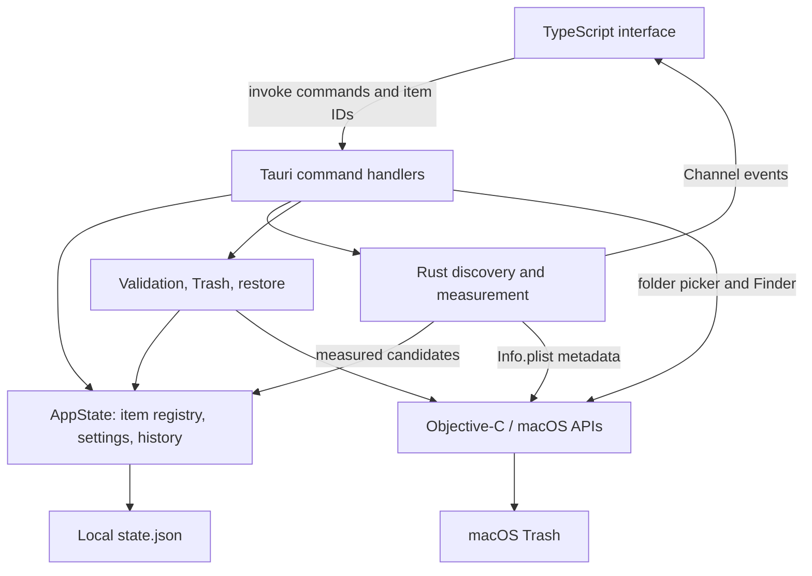

# Architecture and file map

[Documentation index](README.md)

Mac Cleaner is one local desktop process with an embedded frontend. Rust owns scan results, validates every file operation, and persists settings/history. The webview owns presentation and explicit user selection. A small Objective-C bridge calls macOS APIs for Trash, application metadata, application-running checks, folder selection, and Finder.

## Runtime flow

1. Tauri creates `AppState` using the current home and application-data directories. A file lock prevents another instance using the same state directory.
2. The frontend calls `bootstrap`, which reconciles history and returns saved settings and history. Scan results are not loaded from disk.
3. If no project root is configured, the frontend opens the native folder picker before scanning. `scan` runs in a blocking worker. Discovery emits placeholders, four workers measure candidates, and channel events update the interface. An empty root list produces an explicit node_modules-skipped notice.
4. The UI stores selected IDs. The review dialog captures the exact selection; `trash_items` resolves those IDs against the Rust registry.
5. Rust preflights the entire selection, records each intent durably, calls native Trash, verifies the result, and records each outcome.
6. `restore_item` uses a history record, validates its recorded identity and paths, and performs an exclusive rename back to the original location.

There is no HTTP backend, database service, account, telemetry client, filesystem plugin, or shell plugin. The Vite server is development infrastructure only.

## State and concurrency

| State | Owner and lifetime |
| --- | --- |
| Page, filter, sort, details, selection, progress, errors | Frontend memory; reset on reload as appropriate |
| Scan item registry | Rust `HashMap<String, Item>`; replaced by a new scan, cleared when a project root is removed |
| Settings and cleanup history | Rust `Saved`; persisted to `state.json` |
| Busy flag | Atomic flag with a drop guard; serializes scan, bootstrap, root changes, cleanup, and restore |
| Cancel flag | Atomic flag checked by scan discovery/measurement; not a cancellation mechanism for Trash or restore |
| Store mutex | Protects settings, history, and registry access within the process |
| State file lock | `flock` held for the lifetime of `AppState`; prevents concurrent app instances sharing the same data directory |

`scan`, `trash_items`, and `restore_item` use `spawn_blocking` so their filesystem work is not executed directly in the asynchronous command handler. Measurement uses four scoped threads and an atomic work index. Event order across different measured items is therefore not stable.

`set_appearance` uses the store mutex without taking the busy flag. `reveal_item` also reads under that mutex. File operations hold the store lock for their operation, so another command can wait for it. The UI additionally disables conflicting controls, but backend validation remains authoritative.

## Complete source and configuration map

Paths below are relative to the project root. Generated dependency/build directories are described separately.

| File | Responsibility | Detailed reference |
| --- | --- | --- |
| [index.html](../index.html) | Application mount, review dialog, live toast region, frontend entry script | [Frontend](frontend.md) |
| [src/main.ts](../src/main.ts) | UI state, screen templates, rendering, events, IPC orchestration | [Frontend](frontend.md) |
| [src/updates.ts](../src/updates.ts) | Public GitHub release check, numeric version comparison, expected DMG validation, timeout | [Frontend](frontend.md) |
| [src/types.ts](../src/types.ts) | Frontend models, category metadata, size formatting, escaping, selection/total helpers | [Frontend](frontend.md), [data](api.md) |
| [src/icons.ts](../src/icons.ts) | Local SVG icon paths and `icon()` helper | [Frontend](frontend.md) |
| [src/style.css](../src/style.css) | Layouts, component states, responsive rules, focus, reduced motion | [Frontend](frontend.md) |
| [src/tokens.css](../src/tokens.css) | Theme and category color variables | [Frontend](frontend.md) |
| [src/vite-env.d.ts](../src/vite-env.d.ts) | Vite client type declarations | [Development](development.md) |
| [src-tauri/src/main.rs](../src-tauri/src/main.rs) | Startup, command handlers, blocking-worker dispatch | [IPC](api.md) |
| [src-tauri/src/model.rs](../src-tauri/src/model.rs) | Models, locking, durable writes, identity and root validation | [Backend](backend.md) |
| [src-tauri/src/scan.rs](../src-tauri/src/scan.rs) | Discovery, app matching, size measurement, scan events, scanner tests | [Backend](backend.md) |
| [src-tauri/src/cleanup.rs](../src-tauri/src/cleanup.rs) | Selection validation, Trash, reconciliation, restore, safety tests | [Backend](backend.md) |
| [src-tauri/src/native.rs](../src-tauri/src/native.rs) | Rust FFI declarations and native-response conversion | [Backend](backend.md) |
| [src-tauri/native/macos.m](../src-tauri/native/macos.m) | Foundation/AppKit bridge implementation | [Backend](backend.md) |
| [src-tauri/build.rs](../src-tauri/build.rs) | Compile Objective-C, link frameworks, declare app commands for Tauri permissions | [Development](development.md) |
| [src-tauri/Cargo.toml](../src-tauri/Cargo.toml) | Rust package, dependencies, release profile, custom-protocol feature | [Development](development.md) |
| [src-tauri/Cargo.lock](../src-tauri/Cargo.lock) | Resolved Rust dependency versions | [Development](development.md) |
| [src-tauri/tauri.conf.json](../src-tauri/tauri.conf.json) | App identity/version, window, dev/build integration, CSP, bundle configuration | [Safety](safety.md) |
| [src-tauri/capabilities/main.json](../src-tauri/capabilities/main.json) | Main-window command permissions and window dragging | [IPC](api.md) |
| [src-tauri/permissions/autogenerated/](../src-tauri/permissions/autogenerated/) | One generated allow/deny permission file per application command | [IPC](api.md) |
| [src-tauri/icons/app-icon.svg](../src-tauri/icons/app-icon.svg) | Editable app-icon source | [Development](development.md) |
| [src-tauri/icons/icon.png](../src-tauri/icons/icon.png) | Raster bundle icon | [Development](development.md) |
| [src-tauri/icons/icon.icns](../src-tauri/icons/icon.icns) | macOS bundle icon | [Development](development.md) |
| [package.json](../package.json) | Frontend dependencies and all npm scripts | [Development](development.md) |
| [package-lock.json](../package-lock.json) | Resolved npm dependency versions | [Development](development.md) |
| [tsconfig.json](../tsconfig.json) | Strict TypeScript checking, ES2022, bundler module resolution, no emitted JS | [Development](development.md) |
| [vite.config.ts](../vite.config.ts) | Port 1420, strict port use, Rust-directory watch exclusion, Safari 16 output target | [Development](development.md) |
| [tests/ui.test.mjs](../tests/ui.test.mjs) | Node test runner, Playwright browser checks, synthetic IPC fixtures | [Development](development.md) |
| [.gitignore](../.gitignore) | Excludes dependencies, build outputs, screenshots, reports, release installers | [Development](development.md) |
| [README.md](../README.md) | Quick start and high-level behavior | [Index](README.md) |
| [PLAN.md](../PLAN.md) | Original plan and implementation-status context | [Index](README.md) |
| [DESIGN.md](../DESIGN.md) | Design direction | [Frontend](frontend.md) |
| [VALIDATION.md](../VALIDATION.md) | Recorded checks and known validation gaps | [Development](development.md) |
| [example-image.png](../example-image.png) | Supplied UI reference | [Frontend](frontend.md) |
| [documentation/](.) | Current feature and code documentation | [Index](README.md) |

The eleven permission files are `bootstrap.toml`, `scan.toml`, `cancel_scan.toml`, `choose_root.toml`, `remove_root.toml`, `set_appearance.toml`, `trash_items.toml`, `restore_item.toml`, `reveal_item.toml`, `open_trash.toml`, and `open_privacy_settings.toml`. Each corresponds to a command in [the IPC table](api.md#commands).

## Dependencies and generated output

| Component | Dependencies and purpose |
| --- | --- |
| Frontend runtime | `@tauri-apps/api` for IPC, channels, runtime detection, and window dragging; otherwise native DOM/TypeScript |
| Frontend development | TypeScript, Vite, Tauri CLI, Playwright |
| Rust runtime | `tauri`, `serde`, `serde_json`, `libc` |
| Rust build | `tauri-build`, `cc`; system Foundation and AppKit frameworks |
| Rust tests | `tempfile` |

`node_modules/` holds npm dependencies; `dist/` is the frontend production build. `src-tauri/target/` contains Rust artifacts and the `.app` bundle. `src-tauri/gen/` contains generated Tauri schemas. `test-results/` contains UI screenshots, and `release/` contains locally prepared distribution artifacts. These outputs are ignored and are not independent source implementations. Exact dependency resolutions live in the two lockfiles.
